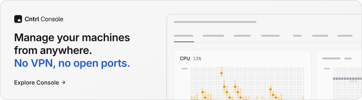

<a href="https://console.cntrl.pw">
  <picture>
    <source media="(prefers-color-scheme: dark)" srcset="apps/docs/public/console-banner-dark.svg">
    
  </picture>
</a>


[](https://github.com/azaek/cntrl/actions/workflows/release-bridge.yml)


## Cntrl Console and the agent

[Cntrl Console](https://console.cntrl.pw) shows your servers and devices live from anywhere, and lets you act on them. Each machine runs the open-source agent in [`crates/cntrl-agent`](./crates/cntrl-agent), written in Rust. It opens one TLS connection out to Console, so nothing on the machine listens and there's no port to forward.

- **Try it:** [the live demo](https://try.cntrl.pw), with made-up machines and no account, or [console.cntrl.pw](https://console.cntrl.pw), free for 3 machines with no card.
- **Add a machine:** one command from Console, on Linux, macOS or Windows (beta). See [Add a device](https://www.cntrl.pw/docs/console/add-a-device).
- **What Console can ask a machine to do:** every operation is in [`crates/cntrl-protocol/src/ops.rs`](./crates/cntrl-protocol/src/ops.rs), each behind a permission the machine's own policy grants. See [Permissions](https://www.cntrl.pw/docs/console/permissions).
- **Signed commands:** a machine can require every change to be signed in a browser you trust, and checks the signature itself. See [Signed commands](https://www.cntrl.pw/docs/console/signed-commands) and [Security](https://www.cntrl.pw/docs/console/security).

## Cntrl Bridge

The programmable API for your desktop. Script your workspace with standard HTTP/WebSockets.

## Apps

| App                         | Description                                                     |
| --------------------------- | --------------------------------------------------------------- |
| **[bridge](./apps/bridge)** | Tauri desktop agent for Windows/macOS - runs a local API server |

## Packages

| Package                             | Description                                      |
| ----------------------------------- | ------------------------------------------------ |
| **[@cntrl-pw/sdk](./packages/sdk)** | TypeScript SDK for interacting with Cntrl Bridge |
| **[@cntrl-pw/ui](./packages/ui)**   | Shared UI components                             |

## Development

### Prerequisites

- [Node.js](https://nodejs.org/) >= 22
- [pnpm](https://pnpm.io/) 10.x
- [Rust](https://rustup.rs/) (for Bridge app)

### Setup

```bash
# Install dependencies
pnpm install

# Run all apps in dev mode
pnpm dev

# Run specific apps
pnpm dev:bridge   # Tauri desktop app
pnpm dev:hub      # Dashboard
pnpm dev:docs     # Documentation
pnpm dev:web      # Website
```

### Building

```bash
# Build all apps
pnpm build

# Build Bridge desktop app
pnpm build:bridge
```

## Bridge App

The Bridge app is a Tauri 2 desktop application that:

- Runs a local HTTP/WebSocket agent for programmable control
- Provides system stats, media control, and power management APIs
- Supports auto-updates with **stable** and **beta** channels

### Auto-Update Channels

Updates are delivered through GitHub Releases:

| Channel | Version Pattern | Example             |
| ------- | --------------- | ------------------- |
| Stable  | `v1.0.0`        | Regular releases    |
| Beta    | `v1.0.0-beta.1` | Pre-release testing |

The app automatically selects the update channel based on its version:

- Stable versions check `latest-stable.json`
- Beta versions check `latest-beta.json`

### Releasing

```bash
# Release stable version
git tag v1.0.0
git push origin v1.0.0

# Release beta version
git tag v1.0.0-beta.1
git push origin v1.0.0-beta.1
```

GitHub Actions will automatically build and publish to the appropriate channel.

## Tech Stack

- [Turborepo](https://turborepo.com/) + [pnpm](https://pnpm.io/) - Monorepo management
- [Tauri 2](https://tauri.app/) - Desktop app framework
- [React 19](https://react.dev/) - UI framework
- [SolidJS](https://solidjs.com/) - Bridge app frontend
- [TanStack](https://tanstack.com/) - Router, Query, Form
- [Tailwind CSS](https://tailwindcss.com/) - Styling

## License

MIT
